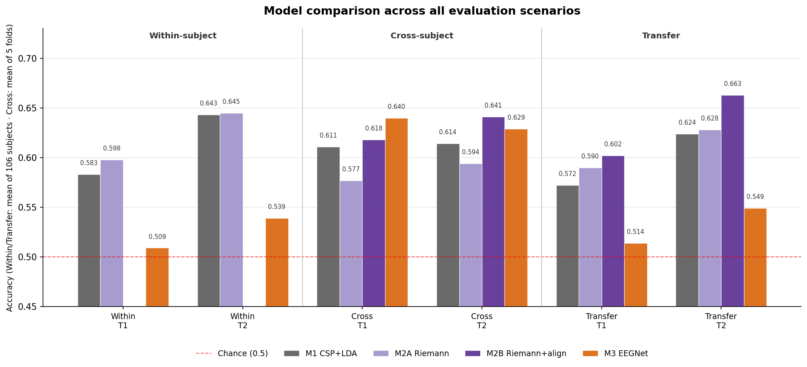
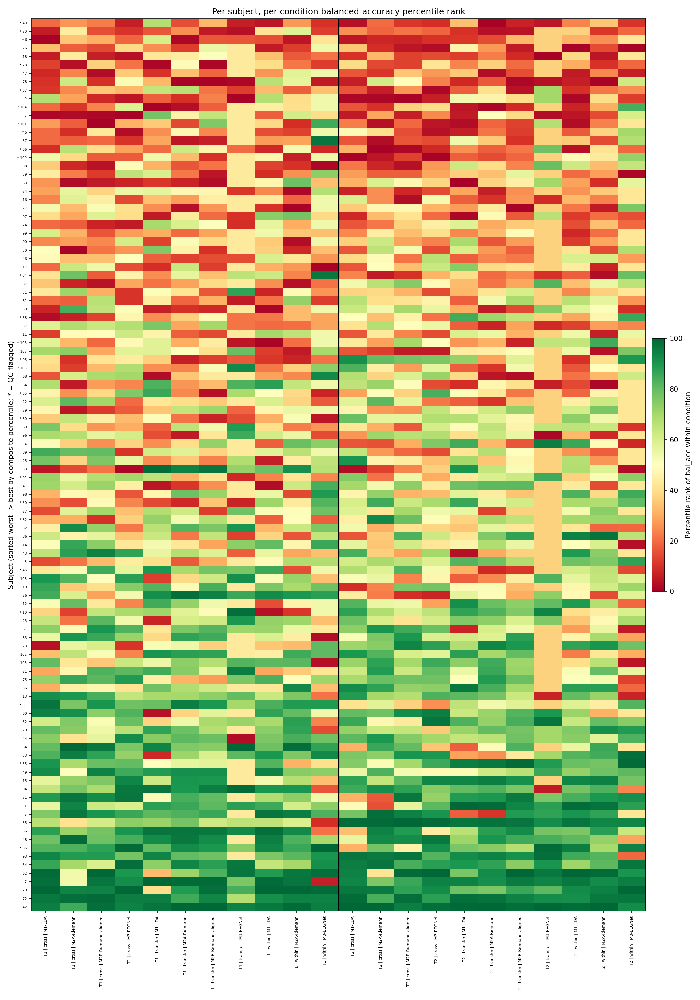

# EEG Motor Imagery Decoding

Classifying imagined hand and foot movements from EEG in 106 subjects. CSP+LDA, Riemannian geometry and EEGNet are compared within subjects, across subjects, and from executed to imagined movement. Individual differences and BCI illiteracy are also examined, as some subjects cannot be decoded reliably by any model.

## Data and tasks

[PhysioNet EEG Motor Movement/Imagery Dataset](https://physionet.org/content/eegmmidb/1.0.0/) (EEGMMIDB): 109 subjects, 64 channels, 160 Hz. Three subjects recorded at 128 Hz (S088, S092, S100) are excluded, leaving 106 (see `preprocessing/data_audit.ipynb`).

| Task | Classes | Imagined runs | Executed runs (transfer training) |
|---|---|---|---|
| Task 1 | left fist vs right fist | 4, 8, 12 | 3, 7, 11 |
| Task 2 | both fists vs both feet | 6, 10, 14 | 5, 9, 13 |

Each model is evaluated in three scenarios:

- **Within-subject**: leave-one-run-out on each subject's imagined runs.
- **Cross-subject**: GroupKFold (5 folds), subjects never split between train and test.
- **Transfer**: train on a subject's executed runs, test on the same subject's imagined runs.

## Experimental setup

| Setting | Value |
|---|---|
| Subjects | 106 |
| Band-pass | 8–30 Hz |
| Analysis window | 0.5–2.5 s after cue |
| Permutations | 200 within-subject, 1000 cross-subject and transfer |
| CSP components (M1) | 6 |
| Max training epochs (M3) | 200 |

All settings live in `modeling/config.py`.

## Pipeline

**Preprocessing** (`preprocessing/preprocess.py`): 1 Hz high-pass → average reference → bad-channel detection (RANSAC) → ICA with ICLabel (artifact components — eye, muscle, heart, line/channel noise — with probability > 0.8 removed) → 40 Hz low-pass → resample to 128 Hz → epochs −0.5 to 4 s. `preprocessing/walkthrough_one_subject.ipynb` shows every step on one recording.

**Models**

| | Model | Features → classifier |
|---|---|---|
| M1 | CSP+LDA | Common Spatial Patterns log-variance → LDA |
| M2A | Riemannian | covariance matrices → tangent space → LDA |
| M2B | Riemannian + alignment | M2A with per-subject recentering of covariances (cross-subject and transfer only) |
| M3 | EEGNet | compact CNN on the raw epochs (braindecode) |

**Statistics**: per-subject permutation tests with Benjamini–Hochberg FDR across subjects; group-level Wilcoxon against chance (within/transfer) or a pooled permutation test (cross); paired Wilcoxon between models on per-subject accuracy, FDR-corrected across all 30 comparisons.

## Results

Mean accuracy (chance = 0.5). Within/transfer: mean over 106 subjects; cross: mean over 5 folds.

| Scenario | Task | M1 CSP+LDA | M2A Riemann | M2B Riemann+align | M3 EEGNet |
|---|---|---|---|---|---|
| Within | T1 | 0.583 | **0.598** | – | 0.509 |
| Within | T2 | 0.643 | **0.645** | – | 0.539 |
| Cross | T1 | 0.611 | 0.577 | 0.618 | **0.640** |
| Cross | T2 | 0.614 | 0.594 | **0.641** | 0.629 |
| Transfer | T1 | 0.572 | 0.590 | **0.602** | 0.514 |
| Transfer | T2 | 0.624 | 0.628 | **0.663** | 0.549 |



Findings (paired Wilcoxon, FDR-corrected):

1. **Within-subject**, CSP+LDA and Riemannian are equivalent (n.s. on both tasks); EEGNet is significantly worse and close to chance.
2. **Cross-subject**, EEGNet is best on Task 1 (0.640, > M1) and Riemannian with alignment is best on Task 2 (0.641, > M1).
3. **Per-subject recentering** improves the Riemannian model significantly in both cross-subject tasks and in Task 2 transfer; executed → imagined transfer on Task 2 is the best result overall (0.663).
4. **EEGNet**, as expected, does well only with many subjects' data (cross-subject); with one subject's trials (within, transfer) it is the weakest model.

## Individual differences

Subjects who are hard for one model are hard for all: per-subject accuracy correlates across models (median Spearman ρ = 0.61, 29/30 pairs significant). 27 of 106 subjects are never significant in any of the 22 model × scenario × task conditions. These are more often flagged in preprocessing QC (41% vs 24% overall; Fisher OR = 3.19, p = 0.020), but 16 of the 27 have clean recordings, so data quality explains only part of it.

<details>
<summary>Per-subject percentile rank across all conditions</summary>



</details>

## Repository structure

```
preprocessing/
  data_audit.ipynb               dataset check, subject exclusion
  walkthrough_one_subject.ipynb  pipeline step by step on one recording
  preprocess.py                  batch preprocessing: raw EDF -> epochs
modeling/
  config.py                      shared settings
  01_csp_lda/                    M1: within (task 1, 2), transfer (task 1, 2), cross
  02_riemannian/                 M2A/M2B: within, cross, transfer, recentering
  03_eegnet/                     M3: within, cross, transfer
analysis/
  m1_csp_results.ipynb           per-model results
  m2_riemann_results.ipynb
  m3_eegnet_results.ipynb
  cross_subject_permtest.py      per-subject significance for cross-subject models
  cross_model_comparison.ipynb   all models, paired tests
  cross_model_underperformers.ipynb
figures/                         figures used in this README
```

## Running

```bash
pip install -r requirements.txt
python preprocessing/preprocess.py               # downloads EEGMMIDB via MNE, writes data/epochs/
python modeling/01_csp_lda/csp_within_task1.py   # ...and the other scripts in modeling/
python analysis/cross_subject_permtest.py
# then the notebooks in analysis/
```
